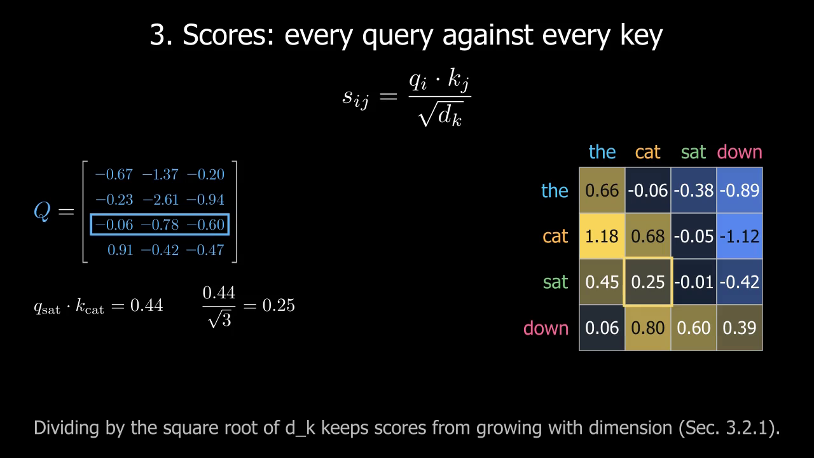
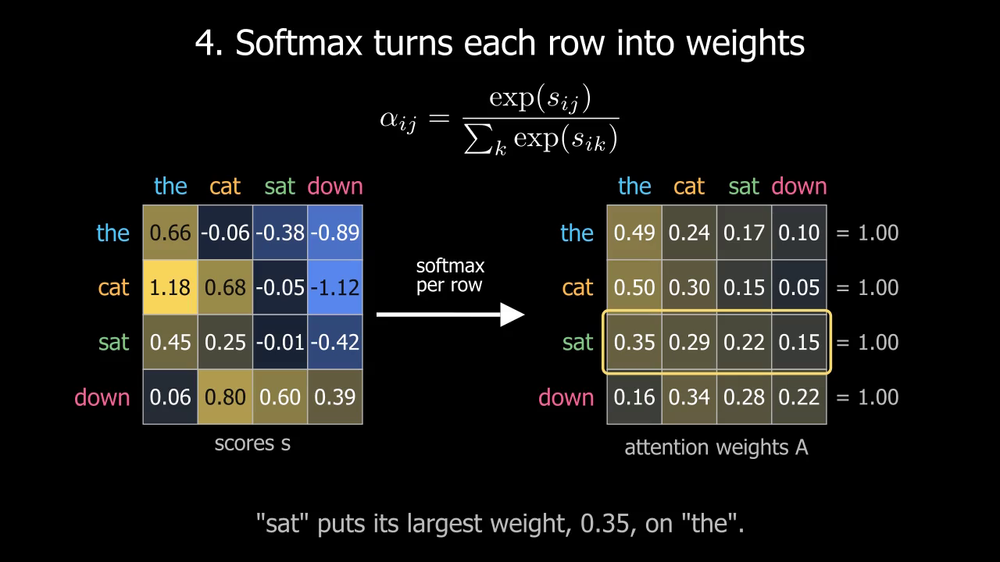
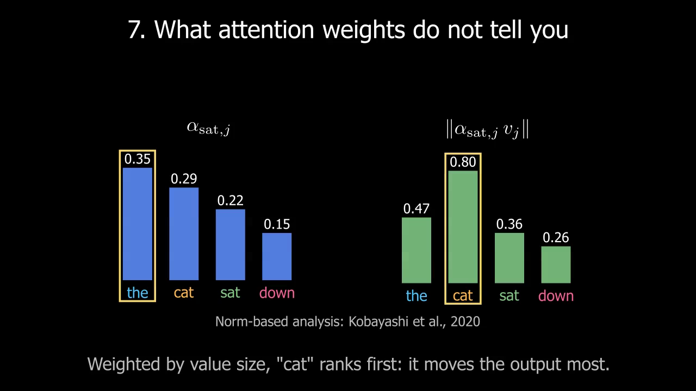

# What Does an AI Model Actually Pay Attention To?

A [Manim](https://www.manim.community/) animation of scaled dot-product
self-attention, from token embeddings to stacked layers. The last part
covers what attention weights can and cannot tell you about a model.

- Paper: Vaswani et al., [Attention Is All You Need](https://arxiv.org/abs/1706.03762), NeurIPS 2017
- Issue: [#3](https://github.com/AbhinandanMandal/BlueprintML/issues/3)
- Length: about 2 minutes 20 seconds, nine parts

Every number on screen comes from a NumPy forward pass in
[`attention_math.py`](src/attention_viz/attention_math.py). The tests check
those numbers against the paper's equation and against this repo's
[`MultiHeadAttention`](../DecoderOnlyTransformer/transformer/attention.py).

## Preview

[`assets/attention_explained_720p.mp4`](assets/attention_explained_720p.mp4) is the full video at 720p.

| Scores | Softmax | Limitations |
|---|---|---|
|  |  |  |

## What each part shows

The full storyboard, with the equation and the values for each part, is in
[STORYBOARD.md](STORYBOARD.md).

| # | Scene class | Content |
|---|---|---|
| 0 | `IntroScene` | Title and Eq. 1 from the paper |
| 1 | `EmbeddingScene` | Tokens become rows of $X = E + PE$, with the sinusoidal encoding from Section 3.5 |
| 2 | `QKVScene` | $Q = XW^Q$, $K = XW^K$, $V = XW^V$ with shapes |
| 3 | `ScoresScene` | One worked dot product, then the full $QK^\top / \sqrt{d_k}$ heatmap |
| 4 | `SoftmaxScene` | Row-wise softmax from scores to weights; each row sums to 1 |
| 5 | `WeightedValuesScene` | $z_{\text{sat}} = \sum_j \alpha_{\text{sat},j} v_j$, then $Z = AV$ |
| 6 | `LayersScene` | Three layers: 2D PCA of the token vectors next to each layer's attention map |
| 7 | `LimitationsScene` | $\alpha$ against $\lVert \alpha v \rVert$ on the same numbers, then five limits with citations |
| 8 | `ReferencesScene` | Reference list |
| | `FullExplainer` | Parts 0 to 8 in order |

## The toy model

| Setting | Value |
|---|---|
| Tokens | `the cat sat down` |
| $d_{model}$ | 4 |
| $d_k = d_v$ | 3 |
| Heads | 1 |
| Layers | 3 |
| Weights | random normal, scaled by $1/\sqrt{\text{fan-in}}$, never trained |
| Layer update | $X_{\ell+1} = \mathrm{LayerNorm}(X_\ell + \mathrm{Attention}(X_\ell) W^O)$ |
| Seed | 7 |

The model is small enough to print every matrix on screen.

### Differences from the paper

- One head instead of eight (Section 3.2.2). Multi-head attention runs this
  same computation in parallel on smaller slices and concatenates the results.
- No position-wise feed-forward sublayer (Section 3.3). The video says so on
  screen.
- LayerNorm has no learned gain or bias.
- No masking. The paper's encoder self-attention is unmasked as well; the
  decoder would add a causal mask.
- Weights are random. The video shows the mechanism, not what a trained model
  learns, and the captions say this where it matters.
- The seed was picked so that Part 7 has a clear example: "sat" puts most
  weight on "the", but "cat" adds the largest vector to the output. Kobayashi
  et al. (2020) report this effect in trained BERT models; the seed only
  makes it visible in a four-token toy. A test fails if the example stops
  holding.

## Setup

Manim needs Python 3.10 or later and a LaTeX install for the equations.

```bash
cd AttentionExplained
pip install -r requirements.txt
```

LaTeX:

- Windows: [MiKTeX](https://miktex.org/) or [TeX Live](https://tug.org/texlive/)
- macOS: [MacTeX](https://www.tug.org/mactex/)
- Linux: `sudo apt install texlive texlive-latex-extra texlive-fonts-extra dvipng cm-super`

On Linux, Manim also needs `libcairo2-dev` and `libpango1.0-dev`. See the
[Manim install guide](https://docs.manim.community/en/stable/installation.html).

### Google Colab

```python
!apt-get -qq install -y libcairo2-dev libpango1.0-dev texlive texlive-latex-extra texlive-fonts-extra dvipng cm-super
!pip install -q manim
!git clone https://github.com/AbhinandanMandal/BlueprintML.git
%cd BlueprintML/AttentionExplained
!manim -ql src/attention_viz/scenes.py FullExplainer
```

The LaTeX install takes a few minutes on Colab.

## Rendering

Run these from `AttentionExplained/`.

```bash
# Quick check, 480p15
manim -pql src/attention_viz/scenes.py FullExplainer

# One part while editing it
manim -pql src/attention_viz/scenes.py SoftmaxScene

# 1080p60 final render
manim -qh src/attention_viz/scenes.py FullExplainer
```

Videos land in `media/videos/scenes/<quality>/`. The `media/` folder is
ignored by git.

On a laptop CPU, the full 720p render takes about 2.5 minutes.

## Tests

```bash
python -m pytest tests -q
```

The tests check:

- every row of every attention matrix is a probability distribution;
- the layer output equals $\mathrm{softmax}(QK^\top/\sqrt{d_k})V$ written out by hand;
- the positional encoding matches the formula in Section 3.5;
- each layer's input is the previous layer's output;
- the Part 7 example ("the" by weight, "cat" by norm) still holds;
- with one head and the same weights, the output matches
  `DecoderOnlyTransformer/transformer/attention.py`. This test needs PyTorch
  and is skipped without it.

## Layout

```text
AttentionExplained/
├── README.md
├── STORYBOARD.md            # Equation and values for each part
├── requirements.txt
├── assets/                  # 720p render and preview frames
├── src/attention_viz/
│   ├── attention_math.py    # NumPy forward pass; source of every number
│   ├── components.py        # Heatmap, token chips, matrices, bar chart
│   └── scenes.py            # One function and one Scene class per part
└── tests/
    └── test_attention_math.py
```

To add a part, write a `part_name(scene, model)` function in `scenes.py`,
wrap it in a `_PartScene` subclass, and add it to `PARTS`.

## Limitations

Of this video:

- It covers one head with random weights. It does not show what heads in a
  trained model attend to.
- The 2D PCA plot in Part 6 drops two of the four dimensions, so distances in
  the plot are approximate.
- The query/key/value descriptions in Part 2 are a common intuition, and the
  video labels them that way.

Of attention weights as explanations, as covered in Part 7:

- A weight does not account for the size of the value vector it multiplies
  (Kobayashi et al., 2020).
- Different weight patterns can give the same prediction (Jain & Wallace,
  2019). Wiegreffe & Pinter (2019) argue this does not make weights useless,
  and the question is still open (Bibal et al., 2022).
- Residual connections let information bypass attention, and after the first
  layer each position holds a mix of tokens (Abnar & Zuidema, 2020; Brunner
  et al., 2020). A late-layer heatmap is not a map between input words.

## References

1. Vaswani, A., et al. (2017). [Attention Is All You Need](https://arxiv.org/abs/1706.03762). NeurIPS.
2. Jain, S., & Wallace, B. C. (2019). [Attention is not Explanation](https://arxiv.org/abs/1902.10186). NAACL.
3. Wiegreffe, S., & Pinter, Y. (2019). [Attention is not not Explanation](https://arxiv.org/abs/1908.04626). EMNLP.
4. Brunner, G., et al. (2020). [On Identifiability in Transformers](https://arxiv.org/abs/1908.04211). ICLR.
5. Abnar, S., & Zuidema, W. (2020). [Quantifying Attention Flow in Transformers](https://arxiv.org/abs/2005.00928). ACL.
6. Kobayashi, G., et al. (2020). [Attention is Not Only a Weight: Analyzing Transformers with Vector Norms](https://arxiv.org/abs/2004.10102). EMNLP.
7. Bibal, A., et al. (2022). [Is Attention Explanation? An Introduction to the Debate](https://aclanthology.org/2022.acl-long.269/). ACL.

Built with [Manim Community](https://www.manim.community/) (MIT licence).
