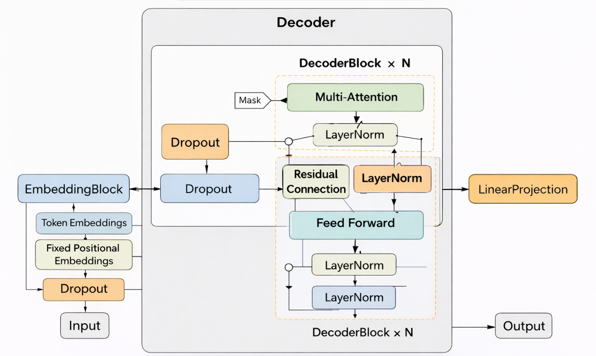

# Decoder-Only Transformer from Scratch

A modular PyTorch implementation of a GPT-style decoder-only Transformer, built from fundamental components to demonstrate causal language modeling, self-attention, and autoregressive text generation.

This implementation is intended for the [BlueprintML](https://github.com/AbhinandanMandal/BlueprintML) paper implementation collection.


## Overview

This project implements a decoder-only Transformer from scratch using PyTorch, with an emphasis on readability, modularity, and understanding the underlying architecture.

The model learns to predict the next token given a sequence of preceding tokens. It uses causal self-attention to ensure that predictions at each position depend only on the available context.

The implementation covers the core components of a GPT-style language model, alongside a training pipeline and autoregressive generation utilities.

Key objectives:

- Understand the internal components of decoder-only Transformers.
- Implement causal multi-head self-attention and feed-forward networks.
- Train a language model from scratch.
- Evaluate model performance using validation loss.
- Provide a reproducible and extensible foundation for further experimentation.

## 1. Features

- Decoder-only Transformer architecture.
- Token embeddings and positional encodings.
- Scaled dot-product multi-head causal self-attention.
- Position-wise feed-forward networks with GELU activation.
- Residual connections and Layer Normalization.
- Dropout-based regularization.
- Next-token prediction using cross-entropy loss.
- AdamW optimization with learning-rate warmup and cosine decay.
- Gradient clipping and validation-based checkpointing.
- Autoregressive text generation with temperature, top-k, and top-p sampling.
- Training and experiment logging with TensorBoard.

## 2. Architecture

The model follows the standard decoder-only language modeling pipeline.

## Architecture Diagram

<p align="center">
  
</p>

### Core components

**Token and positional embeddings**

Token IDs are mapped to dense vector representations. Positional information is incorporated to distinguish tokens by their positions in the input sequence.

**Causal multi-head self-attention**

Queries, keys, and values are projected into multiple attention heads. A causal mask prevents each position from attending to future tokens.

**Feed-forward network**

A position-wise feed-forward network transforms the attention output using an expanded hidden dimension and GELU activation.

**Residual connections and normalization**

Residual connections support information flow through the network, while Layer Normalization helps stabilize training.

**Language modeling head**

The final hidden representations are projected to vocabulary-sized logits. The model is trained to predict the next token in a sequence.

## 3. Model Configuration

The existing reference configuration is shown below. These values should be updated if the final BlueprintML implementation uses a different configuration.

| Parameter | Value |
|---|---:|
| Vocabulary size | 65 |
| Model dimension | 384 |
| Feed-forward dimension | 1536 |
| Number of decoder layers | 6 |
| Number of attention heads | 6 |
| Dropout | 0.2 |
| Training sequence length | 128 |
| Maximum sequence length | 256 |
| Maximum training steps | 200,000 |
| Batch size | 64 |
| Warmup steps | 2,000 |

The original configuration contains approximately 10.66 million parameters. The final parameter count should be verified against the exact configuration used for the BlueprintML submission.

## 4. Repository Structure

The implementation is organized into modular components.

```text
decoder-only-transformer/
├── transformer/
│   ├── attention.py       # Multi-head causal self-attention
│   ├── embedding.py       # Token and positional embeddings
│   ├── block.py           # Transformer decoder block
│   ├── model.py           # Complete language model
│   ├── utils.py           # Utilities and generation helpers
│   ├── train.py           # Training pipeline
│   └── sample.py          # Autoregressive text generation
├── tests/                 # Unit and integration tests
├── data/                  # Dataset or dataset instructions
├── assets/                # Architecture and evaluation figures
├── requirements.txt
└── README.md
```

The final directory structure may be adjusted to match BlueprintML's repository conventions.

## 5. Installation

Clone the BlueprintML repository and navigate to the directory containing this implementation.

```bash
git clone https://github.com/AbhinandanMandal/BlueprintML.git
cd BlueprintML
```

Install the dependencies required by the implementation:

```bash
pip install -r requirements.txt
```

The main dependency is PyTorch. Additional dependencies should be limited to those actually required by the training, evaluation, and logging pipelines.

## 6. Dataset

The reference implementation uses the Tiny Shakespeare corpus for character-level language modeling.

The data pipeline performs the following operations:

- Extracts the vocabulary from the corpus.
- Builds character-to-index and index-to-character mappings.
- Encodes text into integer token IDs.
- Creates sliding-window input and target sequences.
- Splits the data into training and validation sets.

The original split uses 90% of the data for training and 10% for validation.

For next-token prediction, the target sequence is shifted by one position relative to the input sequence.

For example:

```text
Input:   To be or n
Target:  o be or no
```

The model learns to predict each target token using only the preceding input context.

## 7. Training

Run the training script from the appropriate project directory, adjusting the command to match the final repository structure.

```bash
python transformer/train.py
```

The training pipeline includes:

1. Forward propagation through the Transformer.
2. Computation of next-token cross-entropy loss.
3. Backpropagation and gradient clipping.
4. AdamW parameter updates.
5. Learning-rate warmup and cosine decay.
6. Periodic validation.
7. Model checkpointing and training-log recording.

Training should be performed using a fixed configuration and documented random seed wherever possible.

### Checkpoints

The training pipeline can save checkpoints for:

- The best validation-loss model.
- Intermediate training steps.
- The final or early-stopped model.

Generated checkpoints should be excluded from version control unless explicitly required by the contribution guidelines.

## 8. Text Generation

Generate text using a trained model checkpoint:

```bash
python transformer/sample.py
```

The generation pipeline loads the model and its trained weights, processes a prompt, and predicts subsequent tokens autoregressively.

Supported sampling options include:

- **Temperature:** Controls the randomness of the next-token distribution.
- **Top-k sampling:** Restricts sampling to the highest-probability \(k\) tokens.
- **Top-p sampling:** Restricts sampling to a probability-mass-based candidate set.

Generation must respect the model's maximum context length and use the same vocabulary mapping as training.

## 9. Evaluation

Model performance should be evaluated on a held-out validation set.

### Primary metric: Validation loss

Cross-entropy loss measures how well the model predicts the next token. Lower validation loss generally indicates better predictive performance on the evaluation data.

### Evaluation protocol

A reproducible evaluation should report:

- Model configuration and parameter count.
- Dataset and train-validation split.
- Training steps or epochs.
- Optimizer, learning rate, and batch size.
- Training and validation loss.
- Perplexity, where applicable.
- Hardware and approximate training duration.
- Sample generations from fixed prompts.

Results and plots should be added after running the final implementation under the documented configuration. No performance claims should be inferred solely from the model architecture.

## 10. Testing and Reproducibility

The implementation should be tested at both component and model levels.

Recommended checks include:

- Embedding output dimensions and positional encoding behavior.
- Attention output dimensions and causal masking.
- Decoder block and full-model forward passes.
- Correct alignment of next-token inputs and targets.
- Finite loss and gradients during a training step.
- Autoregressive generation within the configured context length.
- A small CPU smoke test that runs without requiring a GPU.

Example test command:

```bash
python -m pytest tests/
```

Use a small model configuration for smoke tests so that basic correctness can be verified without a long training run.

## 11. References

1. Vaswani, A. et al. (2017). *Attention Is All You Need.* [arXiv:1706.03762](https://arxiv.org/abs/1706.03762)
2. Radford, A. et al. (2018). *Improving Language Understanding by Generative Pre-Training.* OpenAI.
3. PyTorch Documentation. [https://pytorch.org/docs/](https://pytorch.org/docs/)

## 12. Acknowledgements

This implementation builds on the foundational ideas introduced in the Transformer literature and uses PyTorch for tensor operations, automatic differentiation, and model training.

This contribution is intended to support BlueprintML's goal of making machine learning architectures easier to understand through clear, modular implementations.

## 13. Contributing

Contributions and suggestions are welcome. Please follow the [BlueprintML contribution guidelines](https://github.com/AbhinandanMandal/BlueprintML/blob/master/CONTRIBUTING.md).

The implementation should prioritize correctness, readability, reproducibility, and clear documentation of architectural choices and experimental results.

## License

Please refer to the BlueprintML repository's license and contribution requirements for the applicable licensing terms.
